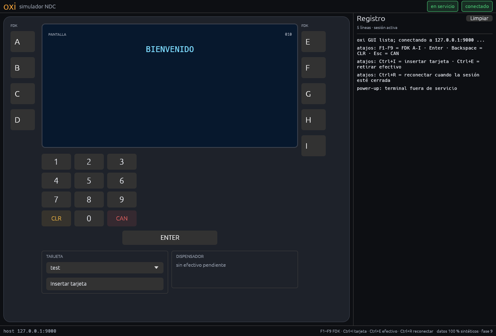

# oxi

Simulador de cajeros **NDC** (APTRA Advance NDC) escrito en Rust, pensado para
probar hosts y drivers de ATM sin necesidad de un cajero físico.

> Proyecto en desarrollo activo. Estado actual: **fases 0–7 y 9 del ROADMAP
> completadas** (parser, red, máquina de estados, hardware virtual, host de
> pruebas, CLI, seguridad de PIN y GUI). La fase 8 (refinos de protocolo) está
> **en progreso**: T8.1 (ITR), T8.2 (rechazos finos + Override), T8.3
> (E/G/C), T8.4a (R/S) y T8.4b (T/b/m) completados; queda el teclado/Q6.
> Ver [`docs/ROADMAP.md`](docs/ROADMAP.md).

---

## Qué es (y qué no es)

**Es** un terminal NDC completo y determinista:

- Parser y serializador de los mensajes NDC (clases 1, 2, 3/1 y 4), validado
  contra una descarga real de un host.
- Máquina de estados del cajero (tipos A, B, D, F, H, I, J, K, W, X, Y) que
  interpreta la customización **que baja tu host**: state tables, pantallas,
  FITs, parámetros de configuración y Config ID.
- Transacciones de punta a punta: tarjeta → PIN → importe → Transaction
  Request → Transaction Reply (dispensar, imprimir, next state, bandera de
  tarjeta) → cierre.
- Hardware virtual: dispensador con 4 casetes, lector con captura por timer,
  impresoras como spool y **catálogo de fallas inyectables**.
- PIN block ISO-0 con DES simple o 3DES (claves de prueba), KVV y cambio de
  clave extendido (EKC).
- Matriz de modos operativos (Power-Up / Out-of-Service / Supply / In-Service)
  con rejects genéricos y específicos, y Time-Out State.

**No es** un HSM ni un cajero real: no hay EPP, ni RSA, ni validación local de
PIN (documentado como opción futura). La GUI de escritorio es una herramienta
de simulación, no un cajero certificado.

---

## Requisitos

- Rust estable. Núcleo y CLI: 1.85+. **GUI: 1.95+** (eframe 0.37). En Windows
  se recomienda compilar/ejecutar desde **WSL** si Smart App Control bloquea
  binarios recién compilados (ver [Problemas comunes](#problemas-comunes)).
- La GUI bajo WSL necesita **WSLg** y las librerías de Mesa/Wayland/X11
  (comando de instalación en [Interfaz gráfica](#interfaz-gráfica-opcional)).
- No requiere base de datos ni servicios externos.

---

## Inicio rápido: demo local

### GUI (para ver el cajero)

Se necesitan **dos terminales**:

```text
# Terminal 1 — host falso (baja la customización y aprueba transacciones)
cargo run -p oxi-host-mock -- --listen 127.0.0.1:9000

# Terminal 2 — GUI (la primera compilación de eframe tarda unos minutos)
cargo run -p oxi-ui --features gui --bin oxi-gui
```

En la ventana: **Insertar tarjeta** (o `Ctrl+I`) → tecleá `1234` + Enter →
tecleá `100` + Enter → cuando aparezca el efectivo, **Retirar efectivo** (o
`Ctrl+E`). La pantalla, el modo, la conexión y el registro se actualizan en
vivo.

> El mock espera 30 minutos de silencio antes de cerrar la sesión; se ajusta
> con `--idle <segundos>`. Si la sesión se cerró, la GUI muestra
> **Reconectar** (`Ctrl+R`) y vuelve a bajar la customización.

### CLI

```text
# Terminal 1 — host falso
cargo run -p oxi-host-mock -- --listen 127.0.0.1:9000

# Terminal 2 — el ATM en texto
cargo run -p oxi-ui
```

Cuando la conexión se establezca vas a ver el log de la descarga y las
pantallas del perfil sintético. Para hacer una transacción:

```text
card test        # insertar la tarjeta de prueba
pin 1234         # PIN + Enter
amount 100       # importe + Enter
cash             # retirar el efectivo dispensado
quit
```

En la terminal del mock vas a ver el resumen: frames intercambiados, la
transacción y los statuses recibidos.

> El mock es **opcional**: oxi se conecta a cualquier host NDC. Se usa para
> demos y para los tests automáticos.

---

## Probar contra tu host real

1. Creá un `perfil.toml` (local, no lo subas si tiene datos de tu empresa):

```toml
[net]
host = "192.168.1.10"   # IP de tu host/driver
port = 9000
max_attempts = 3        # reintentos de conexión

[[cards]]
name = "mia"
# Pista 2 sintética con el FIID que matchee alguna FIT de tu customización
track2 = ";9999990000000000=2512?"

[security]
# Claves de PRUEBA (no reales). Opcional: sin claves, el PIN viaja sin cifrar.
pin_key = "0F1E2D3C4B5A6978"
pin_key_mode = "single"          # o "triple"
master_key = "A1B2C3D4E5F60718"  # para cambios de clave EKC
# local_b_key = "..."            # clave local 'B', opcional
```

2. Arrancá tu host y después:

```text
# CLI
cargo run -p oxi-ui -- --config perfil.toml

# o la GUI (mismo perfil)
cargo run -p oxi-ui --features gui --bin oxi-gui -- --config perfil.toml
```

3. El flujo esperado: oxi conecta → tu host manda sus comandos y su descarga →
oxi responde `Ready` a cada load → tu host lo pone In-Service → el cajero
espera tarjeta con **tus pantallas**. Luego `card <nombre>` y el flujo que
defina tu state table.

### Qué mirar en el log

- `[conexión]` estados de la conexión y reintentos.
- `--- pantalla ... ---` el render aproximado de la pantalla actual.
- `[log]` rechazos, fallas, dispensados, impresiones y transiciones.
- Con `RUST_LOG=oxi_net=trace` se ven los **frames crudos en hex** en ambos
  sentidos (el equivalente al log de bytes del driver).

### Consejos de interoperabilidad

- **Encuadre**: prefijo de 2 bytes big-endian + mensaje ASCII (el mismo que
  usa el driver de referencia del proyecto).
- **Orden del download**: por la matriz del protocolo, la customización se
  acepta en **Out-of-Service** y se rechaza In-Service. Si tu host baja los
  datos estando en servicio, vas a ver `A` (command reject) — es el
  comportamiento de un cajero NCR real.
- **Date/Time**: oxi es estricto con el formato del manual (`YYMMDDHHMM`,
  10 caracteres). Un `YYYYMMDDHHMMSS` de 14 caracteres se rechaza con
  `C/B08` y un warning que explica la divergencia (el flag de tolerancia
  existe en `oxi-core` y está documentado, pero no se expone en el perfil
  todavía).
- **MCN**: oxi valida que el Transaction Reply devuelva el mismo número de
  coordinación del TRQ (o `0` para anular la validación) y responde
  `C/B09` si no coincide.

---

## Interfaz gráfica (opcional)

La GUI es un binario aparte de `oxi-ui` (feature `gui`) construido con
[`egui/eframe`](https://github.com/emilk/egui). Comparte el runtime, el perfil
TOML y el motor con la CLI; no la reemplaza ni la compila si no se pide.



### Requisitos en WSL (WSLg)

Además de WSLg, la distro necesita Mesa y las librerías de Wayland/X11:

```bash
sudo apt install libgl1 libegl1 libgl1-mesa-dri libgles2 \
  libwayland-client0 libwayland-cursor0 libwayland-egl1 libxkbcommon0 \
  libx11-6 libxcursor1 libxrandr2 libxi6 libfontconfig1 mesa-utils
```

Verificá con `glxinfo -B`; si el render es por `llvmpipe` funciona igual
(render por CPU), sólo es más lento que una GPU.

### Atajos de la ventana

| Acción | Mouse | Teclado |
|---|---|---|
| Insertar tarjeta | selector + **Insertar tarjeta** | `Ctrl+I` |
| Dígitos | teclado numérico | `0`–`9` |
| Enter | **ENTER** | `Enter` |
| Clear | **CLR** | `Backspace` |
| Cancel | **CAN** | `Esc` |
| FDK A–I | botones laterales | `F1`–`F9` |
| Retirar efectivo | **Retirar efectivo** | `Ctrl+E` |
| Reconectar | **Reconectar** (sesión cerrada) | `Ctrl+R` |

La barra superior muestra la conexión y el modo operativo; el panel derecho
concentra el registro (rechazos, prints, dispensados, transiciones). La GUI
usa `RUST_LOG=oxi_net=trace` igual que la CLI para volcar frames crudos.

Durante la captura, la pantalla muestra el **eco local** del motor: una `X`
por cada tecla del PIN (manual §2-8) y los dígitos del importe (§2-17). El PIN
nunca se muestra en claro.

### Windows nativo y Smart App Control

oxi es multiplataforma (eframe/glow también compila en Windows), pero
**Smart App Control** bloquea los binarios locales: no sólo el `.exe` final,
también los **build scripts**, los **proc-macros** y hasta `rustfmt`
(`os error 4551`). En esta máquina ni `cargo check` nativo llega al final; el
código no es el problema. El detalle y la evidencia están en
[`docs/WINDOWS-SAC.md`](docs/WINDOWS-SAC.md).

- **Seguir en WSLg** (recomendado si no querés cambiar la seguridad de
  Windows): la ventana se ve como una app nativa y usa el mismo binario.
- **Desactivar Smart App Control**: Seguridad de Windows → Control de
  aplicaciones y navegador → Smart App Control → **Desactivado**. En builds
  recientes (Windows 11 25H2 actualizado) se puede **volver a activar sin
  reinstalar**; en builds viejas era unidireccional. Verificá el toggle y que
  los datos de diagnóstico opcionales estén activos. Después, el trío
  `cargo fmt/clippy/test` y la GUI corren nativos:

  ```powershell
  cargo run -p oxi-ui --features gui --bin oxi-gui -- --config perfil.toml
  ```

- **Acceso directo sin tocar SAC**: apuntarlo a WSLg.

  ```powershell
  wsl.exe -e bash -lc "cd /mnt/c/Users/luisa/Desktop/oxi-atm && cargo run -p oxi-ui --features gui --bin oxi-gui -- --config perfil.toml"
  ```

No hay una exclusión de Smart App Control para binarios locales, y firmar el
`.exe` no destraba los build scripts de Cargo. Un certificado **autofirmado**
tampoco alcanza: SAC exige una CA del *Microsoft Trusted Root Program* (o una
predicción favorable de su nube). Para desarrollo nativo, la vía práctica es
desactivar SAC (decisión tuya) o usar una máquina/VM sin SAC.

> Verificado en Windows 11 25H2 con SAC desactivado: `cargo build`, `cargo
> fmt --check`, `cargo test --workspace` y la GUI nativa contra el mock nativo
> funcionan.

---

## Comandos de la CLI

| Comando | Efecto |
|---|---|
| `card <nombre>` | Inserta una tarjeta del perfil |
| `pin <dígitos>` | Teclea el PIN y confirma (Enter) |
| `amount <dígitos>` | Teclea un importe y confirma (Enter) |
| `fdk <A-I>` | Pulsa una tecla funcional |
| `enter` / `clear` / `cancel` | Teclas especiales |
| `cash` | Retira el efectivo dispensado |
| `help` | Ayuda |
| `quit` | Cierra la sesión |

---

## Estructura del workspace

| Crate | Rol |
|---|---|
| `oxi-core` | Tipos y parser/serializador NDC (sin I/O, sin tokio) |
| `oxi-engine` | Máquina de estados, customización, hardware virtual, PIN (sin tokio) |
| `oxi-net` | TCP, encuadre 2B-BE, reconexión (tokio) |
| `oxi-host-mock` | Host falso guionizado + fixtures sintéticas canónicas |
| `oxi-ui` | Ensamblado (runtime + CLI + GUI opcional con `--features gui`) |

Documentación de diseño: [`docs/SPEC.md`](docs/SPEC.md) (protocolo),
[`docs/ARCHITECTURE.md`](docs/ARCHITECTURE.md),
[`docs/DESIGN.md`](docs/DESIGN.md) y [`docs/ROADMAP.md`](docs/ROADMAP.md).

---

## Desarrollo

Trío de calidad (obligatorio antes de cada commit):

```bash
cargo fmt --check
cargo clippy --all-targets --all-features --locked -- -D warnings
cargo test
```

En Windows con WSL (recomendado si Smart App Control bloquea los binarios):

```bash
wsl -e bash /mnt/c/.../oxi-atm/scripts/check-wsl.sh
```

`clippy --all-features` compila también la GUI (eframe); es la verificación
completa. `cargo test` sin features no arrastra las dependencias gráficas.

Los tests usan únicamente **datos sintéticos** construidos por el proyecto
(fixtures de `oxi-host-mock`); no se versionan datos reales de ninguna empresa.

## Problemas comunes

| Síntoma | Causa probable / solución |
|---|---|
| `os error 4551` al ejecutar tests, binarios o build scripts | Smart App Control bloquea binarios sin firma/reputación (incluidos build scripts y proc-macros de Cargo). Compilá/ejecutá desde WSL, o desactivá Smart App Control (en builds recientes se puede volver a activar). Ver [`docs/WINDOWS-SAC.md`](docs/WINDOWS-SAC.md). |
| La GUI no abre o falla al crear el contexto | Faltan Mesa/Wayland/X11 en WSL. Instalá el paquete de [Interfaz gráfica](#interfaz-gráfica-opcional) y verificá con `glxinfo -B`. |
| El mock cierra la sesión si no pasa nada | Su silencio máximo es 30 min. Ajustalo con `--idle <segundos>` (por ejemplo `--idle 7200`). |
| El host no logra conectar o no llega nada | oxi **conecta hacia** el host (rol cliente TCP). Verificá IP/puerto del perfil y que el host esté escuchando. |
| `command reject` en la descarga | Orden: la customización se acepta en Out-of-Service (revisá el modo del terminal). |
| `C/B08` al bajar fecha/hora | El host manda 14 caracteres; el manual exige 10 (`YYMMDDHHMM`). |
| `C/B09` en el Transaction Reply | El MCN del reply no coincide con el del TRQ (mandá `0` para anular). |
| El PIN no viaja en el TRQ | Sin `pin_key` configurada viaja el bloque ISO-0 sin cifrar; con clave, cifrado. Revisá el estado I y la FIT (verificación remota). |

---

## Licencia

Apache-2.0. Ver [`LICENSE`](LICENSE).
