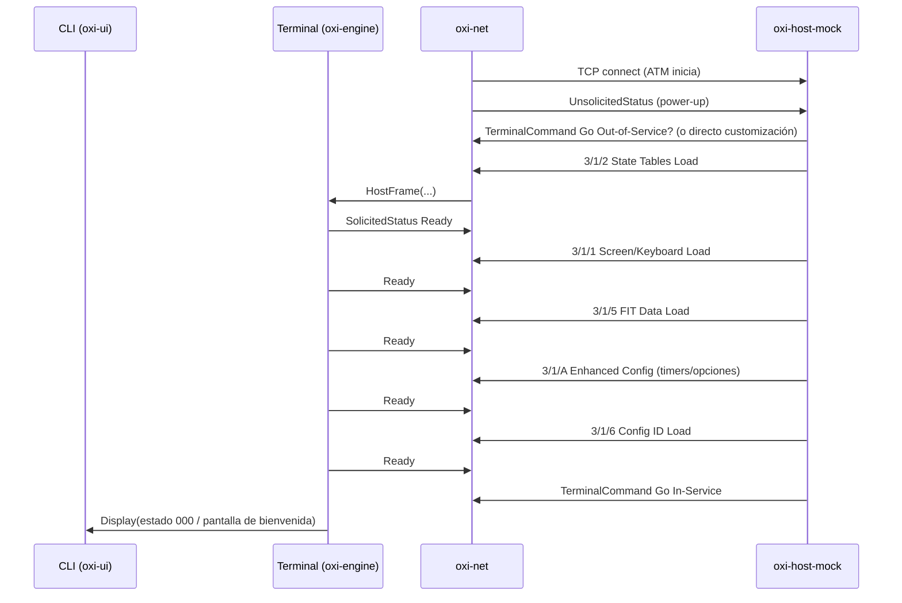
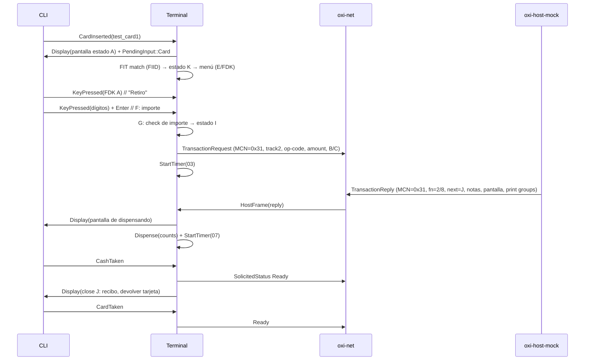

# DISEÑO DEL SISTEMA — oxi

> **Estado**: propuesta v0.1 para revisión del dueño.
> Complementa a `docs/ARCHITECTURE.md` (estructura) y `docs/SPEC.md` (protocolo). Aquí se baja a
> componentes, tipos de datos, algoritmos y decisiones de diseño con justificación.
> Los identificadores van en inglés (código futuro); la prosa en español (convención de AGENTS.md).

## 1. Vista de componentes

```mermaid
flowchart LR
  subgraph runtime[oxi-ui · runtime glue (tokio)]
    RT{{Supervisor de tareas}}
    TMR[Scheduler de timers]
    CLI[CLI / futura GUI]
  end
  subgraph net[oxi-net]
    CONN[Conexión TCP ATM→host]
    CODEC[Codec de encuadre]
  end
  subgraph engine[oxi-engine · Terminal (puro)]
    LOOP[Loop de eventos handle(Event)→Vec&lt;Action&gt;]
    MODES[Modos operativos]
    STM[Intérprete de state tables]
    BUF[Buffers + MCN + contexto tx]
    HW[Hardware virtual]
    CRYPT[Puerto criptográfico]
  end
  subgraph core[oxi-core]
    P[Parser FS/GS]
    S[Serializador]
    TYPES[Enums de mensaje]
  end
  subgraph mock[oxi-host-mock]
    HM[Host falso: guiones + auto-reply]
    FX[Builder de fixtures sintéticos]
  end

  CONN -->|bytes| CODEC -->|HostMessage| RT
  HM -.->|TCP localhost (tests)| CONN
  RT -->|Event::HostFrame| LOOP
  CLI -->|Key/Card events| RT
  TMR -->|Event::TimerFired| RT
  LOOP -->|Actions: SendMessage| RT --> CONN
  LOOP -->|Actions: Display/Log| CLI
  LOOP -->|Actions: StartTimer/Cancel| TMR
  LOOP -->|Actions: Dispense/Eject/Print| HW
  LOOP <--> TYPES
  P <--> TYPES <--> S
```

## 2. oxi-core — modelo de mensajes

### 2.1 Tipos

Dos enums summa representan el cable (estructura según SPEC §3–§4):

```rust
/// Mensaje que llega del host al ATM.
pub enum HostMessage {
    TerminalCommand { luno: String, seq: Option<String>, command: TerminalCommand },
    CustomisationData { id: CustomisationId, payload: CustomisationPayload },
    InteractiveTransactionResponse { display_flag: char, active_keys: KeyMaskBin, screen_timer: String, screen_data: String },
    TransactionReply { next_state: StateNumber, notes: NoteCounts, serial: String, function_id: char, screen: ScreenSelector, mcn: char, card_return: CardReturnFlag, print_groups: Vec<PrintGroup>, track_write: Option<TrackWrite> },
    EncryptionKeyChange { .. },
    ExtendedEncryptionKeyChange { .. },
    EJCommand { .. },
    EmvConfiguration { .. },
    Unknown { class: char, subclass: Option<char>, raw: RawFields },
}

/// Mensaje que el ATM envía al host.
pub enum TerminalMessage {
    TransactionRequest { .. },          // SPEC §3
    InteractiveResponse { buffer_b: String },
    SolicitedStatus { descriptor: StatusDescriptor, data: StatusData },
    UnsolicitedStatus { device: DeviceId, data: DeviceStatus },
    EncryptorInitData { .. },
}
```

- **Rust nota 1 — enums summa**: a diferencia del simulador C# previo (todo `string`), cada
  variante lleva solo sus campos: el compilador nos obliga a cubrir todos los casos en cada
  `match` (exhaustividad), así agregar un mensaje nuevo rompe el build en los lugares que
  importa, no en runtime.
- `Unknown { .. }` preserva el mensaje crudo (tolerant reader, ARCHITECTURE §1.4): se loguea y
  se resuelve por la matriz de modos operativos.
- `StateNumber = u16` con validación de rangos 000–254/256–999 y `DISABLED = 255` como constante
  nombrada (SPEC §5.1).

### 2.2 Parser y serializador

- Un mensaje en el cable = campos separados por FS (0x1C); GS (0x1D) separa subgrupos dentro de
  un campo (p.ej. grupos de impresión del Transaction Reply).
- El parser es de dos niveles: (1) `split_message(bytes) -> RawFields` (nivel genérico,
  protocolo-agnóstico); (2) `parse_host(RawFields) -> HostMessage` y
  `parse_terminal(RawFields) -> TerminalMessage` (nivel semántico).
- El serializador es el inverso exacto. **Propiedad obligatoria**: `serialize(parse(x)) == x`
  para mensajes válidos — se verifica con proptest en cada variante.
- Validaciones de forma (FS mal ubicado, campos insuficientes) producen `ParseError`, que el
  engine traduce a Command Reject / Specific Command Reject (SPEC §4.5), nunca a pánico.

## 3. oxi-engine — Terminal

### 3.1 Estructura (borrador de tipos)

```rust
pub struct Terminal {
    // customización descargada (se reemplaza en cada load)
    states: HashMap<StateNumber, StateTable>,
    screens: HashMap<ScreenId, ScreenData>,
    fits: BTreeMap<FitNumber, Fit>,
    config: ConfigParams,            // LUNO, timers, opciones ECPL (SPEC §11)
    config_id: Option<String>,

    // estado corriente del terminal
    mode: OperationalMode,           // PowerUp | OutOfService | Supply | InService
    current: Option<StateNumber>,
    buffers: Buffers,                 // card tracks, pin, b, c, amount, opcode, fdk
    mcn: McnCounter,                  // 0x31..0x3F rotativo (SPEC §2)
    tx: Option<TxContext>,            // serial, TRQ enviado, Reply esperado
    pending: Option<PendingInput>,    // qué espera el estado actual (teclas/tarjeta/timer 03)
    hardware: VirtualHardware,        // casetes, lector, impresoras, sensores
    clock_seq: u64,                   // para TVN en fases con MAC
}

pub struct Buffers {
    pub card: CardTracks,            // pista 1/2/3 sintéticas + FIID
    pub pin: String,                 // dígitos capturados
    pub b: String, pub c: String,
    pub amount: String,              // 8 o 12 dígitos según opción 1/008
    pub opcode: OpCodeBuffer,        // 8 posiciones, edición por D/E/X
    pub fdk: Option<KeyCode>,        // para W
}
```

- **Rust nota 2 — ownership**: `Terminal` es dueño de todo su estado; `handle(&mut self, ..)`
  toma el control exclusivo durante el evento (borrow único), lo que elimina carreras por
  diseño: no hay locks ni shared state.
- La customización se guarda `Arc`-inmutable por load si las pantallas crecen (decisión diferida
  a la fase de pantallas; hoy HashMap simple).

### 3.2 Loop de eventos

```rust
impl Terminal {
    pub fn handle(&mut self, ev: Event) -> Vec<Action> { /* router */ }
}
```

Enrutado por evento:

| Evento | Manejo | Emite típico |
|---|---|---|
| `HostFrame(msg)` | matriz de modo operativo (SPEC §4.5) → aceptar/rechazar/retener → semántica del mensaje | `SendMessage(SolicitedStatus::Ready)` o customización aplicada |
| `KeyPressed(code)` | si hay `PendingInput::Keys(mask)`: máscara (SPEC §5.3) → transición; si no, ignorar | `Display`, transición |
| `CardInserted(card)` / `CardTaken` | alimenta estados A/T y bandera de retiro | transición / captura |
| `CashTaken` / `CashRetracted` | cierra función de dispensado (SPEC §4.3) | `SendMessage(SolicitedStatus::Ready)` |
| `TimerFired(id)` | Time-Out State (00), respuesta C00 (01), TRQ sin respuesta (03), presentación (07)… | `Display(C00)`, reject, transición |
| `FaultInjected(dev)` (tests/perfil) | evento unsolicited | `SendMessage(UnsolicitedStatus)` |

**Rust nota 3 — `Vec<Action>` en vez de callbacks**: el engine no llama a la red ni a la UI;
devuelve "intenciones". Quien ensambla decide qué hacer con ellas (ejecutar, grabar, asertar).
Esta inversión es lo que permite probar el motor como una función pura.

### 3.3 Intérprete de state tables

```
fn enter_state(n):
    tabla = states[n] o default_close
    match tabla.tipo:
      A: si hay tarjeta → good_read_next_state; si no → mostrar pantalla y PendingInput::Card
         (con read conditions de SPEC §5.2 evaluadas en orden)
      B/M: PendingInput::Pin(max=FIT.PMXPN) con FDK 'A'/Enter
      D: escribir máscaras en opcode → next_state
      E/Y: PendingInput::Keys(mask por entradas ≠ 255) + guardar keycode/FDK
      F/R: PendingInput::Amount + echo
      G: evaluar condición 000–003 sobre amount → salidas
      H/X: PendingInput::Info(buffer B/C) / traducción FDK→valor
      I: armar TRQ (MCN, pistas, op-code, importe, PIN…) → SendMessage + timer 03
         + PendingInput::TransactionReply
      J: close (devolver tarjeta→timer 09, recibo, statement→timer 95/96)
      K/_: FIT switch por índice; W: por FDK buffer; S: por idioma; V: por código de tarjeta
      T: como A + habilitación temprana de teclado (DASH/EMV)
      otros: extensión 'Z' u "no soportado en v1" → log + default_close (decisión por fase)
```

- Cada `enter_state` termina en: nueva transición, `PendingInput` (con `StartTimer` del timer
  correspondiente) o `SendMessage`. El engine nunca bloquea.
- Extension states: el load las adjunta como estados tipo `Z`; el intérprete las lee como
  entradas 2–9 de su estado base (SPEC §5.2).
- Los tipos no soportados en v1 (`>`, `w`, `k`, `m`, `L`, `V` según fase) se declaran en el
  ROADMAP; encontrarse con uno configurado = log warning + default close (comportamiento
  conservador, no inventado).

### 3.4 Timers virtuales

- El engine no mide tiempo: emite `Action::StartTimer { id: u8, after: Duration }` calculando la
  duración desde `config.timers[id]` (ticks de 800 ms en CPL; segundos en ECPL — SPEC §11) y
  cancela al salir del estado que lo pidió.
- El runtime (oxi-ui) programa con `tokio::time::sleep` e inyecta `Event::TimerFired(id)`.
- En tests unitarios: se inyecta `TimerFired` directamente — cero reloj real, cero flakiness.
- Esta separación replica el modelo del manual: los números de timer son parte de la
  customización, no del hardware.

### 3.5 Hardware virtual

```rust
pub struct VirtualHardware {
    pub dispenser: Dispenser,        // 4 casetes con conteos, presentación/retract
    pub reader: CardReader,         // lectura sintética de pistas por tarjeta de perfil
    pub receipt: PrintSpool,         // log estructurado de líneas de recibo
    pub journal: PrintSpool,
    pub sensors: SensorState,        // puertas, tamper, suministros (para unsolicited)
}
```

- Dispensado: recibe `Action::Dispense(counts)`, valida total ≤ 40 (SPEC §4.3), simula
  presentación (espera `CashTaken` o timer 07 → retract con unsolicited, SPEC §5.4/§4.3).
- Inyección de fallas por perfil (Q9 resuelta: **catálogo completo** — SPEC §13): jam de
  lector/dispensador, dispensado parcial, casetes vacías, papel/impresoras, encryptor, reloj,
  energía, tamper/puertas — cada una con su estado unsolicited/solicited correcto.
- BNA/CPM: no configurados en v1 → function IDs que los requieren producen Specific Command
  Reject `C02`/`C18` (SPEC §13).

### 3.6 Puerto criptográfico (fase security)

```rust
pub trait PinCrypto {
    fn build_pin_block(&self, pin: &str, pan: &str, fmt: PinBlockFormat) -> PinBlock; // ISO-0/3/BANKSYS (SPEC §12)
    fn encrypt_under(&self, key: &KeyRef, block: &PinBlock) -> CipherBlock;
    fn kvv(&self, key: &KeyRef) -> CheckValue;                       // 3DES(0^8), 6 hex (SPEC §12)
    fn apply_key_change(&mut self, cmd: &EncryptionKeyChange) -> Result<(), KeyError>;
}
```

- Implementación v1 por decisión del dueño (Q8): **ISO-0 + 3DES con claves de prueba
  sintéticas** del perfil, verificación remota (PIN block en el TRQ).
- Opciones diseñadas y documentadas (se activan por perfil sin rediseño): verificación local
  vía FIT (PEKEY/POFDX/PDCTB), ISO-3/BANKSYS (PBFMT), MAC/TVN con tabla de selección.
- Trait para poder stubbar en tests del engine y para aislar la elección de crate cripto.

## 4. oxi-net — transporte

```rust
pub trait FrameCodec {                      // encuadre configurable (Q1 RESUELTO: 2B BE)
    fn decode(&mut self, buf: &mut BytesMut, out: &mut Vec<Vec<u8>>) -> Result<(), NetError>;
    fn encode(&mut self, payload: &[u8], out: &mut BytesMut);
}
pub struct LenPrefix2BE;                    // default confirmado por el dueño: 2 bytes big-endian
```

- Tareas: `connect_loop` (backoff exponencial, estado de conexión observable), `read_loop`
  (codec → `Event::HostFrame`), `write_loop` (acciones → bytes).
- Trazas: cada frame en hex con dirección y longitud (el "log de bytes" que ya probaste útil en
  el simulador C#).
- `oxi-net` no parsea mensajes: entregan bytes decodificados y el core parsea (una sola fuente
  de verdad del parser).

## 5. oxi-host-mock — host falso

- Binario CLI: escucha TCP, ejecuta un **guion** por conexión:
  1. espera power-up → baja customización sintética (states+screens+FITs+ECPL+Config ID, cada
     mensaje espera `Ready`),
  2. `Go In-Service`,
  3. modo **auto**: TRQ → TR aprobado (function 2/8, next state J) o rechazado (pantalla de
     error + estado X) según regla configurable (monto, FIID, siempre, aleatorio),
  4. responde terminal commands (Config ID, supply counters, config info) con datos sintéticos.
- Como librería (`oxi_host_mock::ScriptedHost`) se usa en los tests de integración de `oxi-ui`.
- `fixtures::builder`: genera state tables/pantallas/FITs sintéticos — único origen permitido de
  datos de customización en todo el repo (regla de confidencialidad).

## 6. oxi-ui — ensamblado e interfaz

- Lib: `runtime::spawn(terminal, net_config, channels) -> RuntimeHandle` — el glue tokio
  (ARCHITECTURE §3). Reutilizado por el binario y por los tests de integración.
- Bin v1 (CLI): comandos `connect`, `card <perfil>`, `pin <dígitos>`, `fdk A|B|...`,
  `enter/clear/cancel`, `dump states|screens|fits|buffers`, `inject fault ...`.
- Salida: log estructurado + pantalla "de texto" renderizando las pantallas NDC en el terminal
  (suficiente para seguir una transacción de punta a punta).

## 7. Configuración del simulador (serde, TOML)

```toml
# perfil sintético de ejemplo (no datos reales)
[terminal]
luno = "001"
config_id = "SYN-001"

[net]
host = "127.0.0.1"
port = 12345
framing = "len2be"          # confirmado por el dueño (Q1); len2le|none por robustez
reconnect_backoff_ms = 1000

[fit.default]               # FIT sintética de pruebas
pfiid = "444444FFFF"
pstdx = "01"
pbfmt = "iso0"

[card.test_card1]
track2 = "444444...=2412"   # sintética
fiid  = "444444"

[security]                  # opciones documentadas (Q4/Q8): v1 usa el default ISO-0 sin MAC
pin_block_format = "iso0"   # iso0 (default) | iso3 | banksys | local_pekey
master_key = "0123456789ABCDEF0123456789ABCDEF"   # clave de PRUEBA, sintética
mac_enabled = false         # activable: tabla de selección + TVN

[hFaults]                   # catálogo completo de fallas (Q9: "todas las posibles")
cash_handler_jam = false
cash_handler_partial = false
card_reader_jam = false
card_reader_read_error = false
receipt_printer_paper_out = false
journal_printer_failure = false
depository_full = false
encryptor_failure = false
clock_failure = false
power_failure = false
tamper = false
door_open = false
cassette_low_threshold = 10
```

- Todo con `serde` + `clap` para overrides de CLI. Sin secretos: claves de prueba públicas
  dentro del repo de tests.

## 8. Flujos representativos

### 8.1 Power-up y descarga de customización



### 8.2 Transacción aprobada (retiro)



### 8.3 Excepciones

- **TRQ sin respuesta** → `TimerFired(03)` → Cancel transacción + estado por salida de
  time-out del estado I (SPEC §5.2 I) → C00 si corresponde (SPEC §5.4).
- **MCN desmatch** → Command Reject (`A`) o Specific Reject `C/B09` con opción 12 (SPEC §4.5).
- **Timer 00 en estado de teclado** → Time-Out State: C00 + beep + timer 01; FDK 'A' reintenta,
  FDK 'B'/timer 01 → salida time-out del estado original (SPEC §5.4).

## 9. Taxonomía de errores (por crate)

| Crate | Error | Origen típico | Estrategia |
|---|---|---|---|
| oxi-core | `ParseError::MalformedFrame` / `Unsupported { .. }` | FS mal ubicado, clase ilegal, campo corto | `Result`; el engine decide reject vs Unknown |
| oxi-engine | `EngineError::NoStateTable` / `InvalidCustomisation` | customización incompleta | default close state o reject según SPEC; nunca pánico |
| oxi-net | `NetError::Framing` / `Io` / `Closed` | transporte | reconexión con backoff; estado visible en UI |
| oxi-host-mock | `ScriptError` | guion mal armado | aborta el test con contexto |
| oxi-ui | errores de runtime | canal cerrado, config inválida | degradación + log |

## 10. Decisiones de diseño (ADR resumidos)

| # | Decisión | Alternativa descartada | Por qué |
|---|---|---|---|
| D1 | Enum summa por mensaje (core) | struct con `type: String` | exhaustividad del `match`; menos estados inválidos representables |
| D2 | Engine síncrono puro, I/O en el borde | engine async con tokio | testeable sin runtime; el manual es un protocolo de turnos, no necesita concurrencia interna |
| D3 | Timers virtuales (Event::TimerFired) | timers reales dentro del engine | determinismo en tests; duraciones son customización, no hardware |
| D4 | Tolerant reader con `Unknown` | rechazar todo lo no modelado | el host real puede mandar variantes; el manual solo define qué es *ilegal* |
| D5 | Codec de encuadre como trait con default 2B-BE | hardcodear framing | Q1 abierto; cambia una implementación, no el diseño |
| D6 | Customización como almacenes reemplazables (HashMap/BTreeMap) | structs con Option por campo | los loads pisan contenido y el terminal debe servir con cualquier subset |
| D7 | Hardware virtual con inyección de fallas por perfil | hardware siempre perfecto | el valor del simulador está en probar la gestión de fallas del host |
| D8 | `Vec<Action>` en vez de callbacks/channels desde el engine | observer inmediato | orden explícito, asertable, sin reentradas |
| D9 | Cripto detrás de trait `PinCrypto` | cripto inline | permite stubs y aislar dependencias (Q4/Q8 abiertos) |
| D10 | Fixtures construidas por builder en oxi-host-mock | fixtures literales | regla de confidencialidad + versionables como código |

## 11. Notas de Rust para el dueño (patrones que verás en el código)

1. **Ownership y `&mut self`**: `Terminal::handle` pide prestado exclusivo el estado; el
   compilador garantiza que nadie más lo toca durante el evento. Viene a reemplazar los locks y
   `Invoke` del simulador C#.
2. **Enums + `match` exhaustivo**: el "switch" de tipos de mensaje/estado, pero que no compila si
   falta un caso.
3. **Traits como puertos** (`FrameCodec`, `PinCrypto`): la misma idea que una interfaz, pero sin
   herencia de implementación; cada borde del sistema tiene su contrato mínimo.
4. **`Result` en vez de excepciones**: los errores de protocolo son valores que se propagan
   explícitamente; nada "explota" en runtime por un mensaje malformado.
5. **async/await solo en oxi-net/oxi-ui**: `tokio` es un runtime de tareas cooperativas; lo
   usamos exclusivamente para I/O y timers, nunca dentro de la lógica del protocolo.
6. **Canales `mpsc`**: la forma idiomática de tokio para pasar eventos entre tasks (red→engine,
   engine→UI); reemplazan los `Thread` + marshalling de la UI del simulador previo.

## 12. Puntos abiertos que afectan este diseño

- ~~Q1~~ resuelto: `LenPrefix2BE` confirmado como codec default (sigue configurable por D5).
- ~~Q3~~ resuelto: host solo Advance NDC; los comandos clásicos no documentados entran por
  `Unknown` sin casos especiales.
- ~~Q9~~ resuelto: catálogo completo de fallas de dispositivos modelados, inyectables por
  perfil (§9-63…§9-91 de SPEC).
- Q11 (nuevo) → si el dueño aporta un "Download" real como fixture local, el builder de
  fixtures de `oxi-host-mock` gana un modo "replay local" (fuera del repo).
- Q6 → si la descarga real trae asociaciones pantalla↔teclado, `ScreenData` guarda el campo y
  el engine lo ignora/usa según la respuesta.
- Q5/Q10 → detalles del intérprete (tipos P/Q/i/Z y número de default close).
